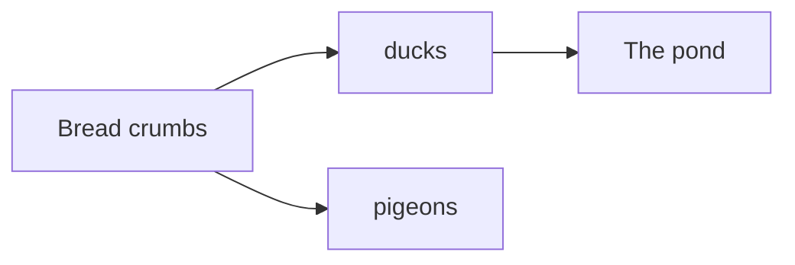
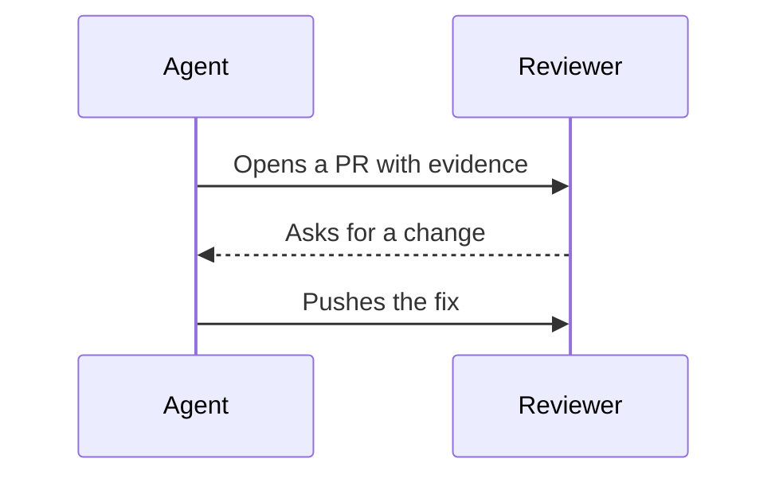
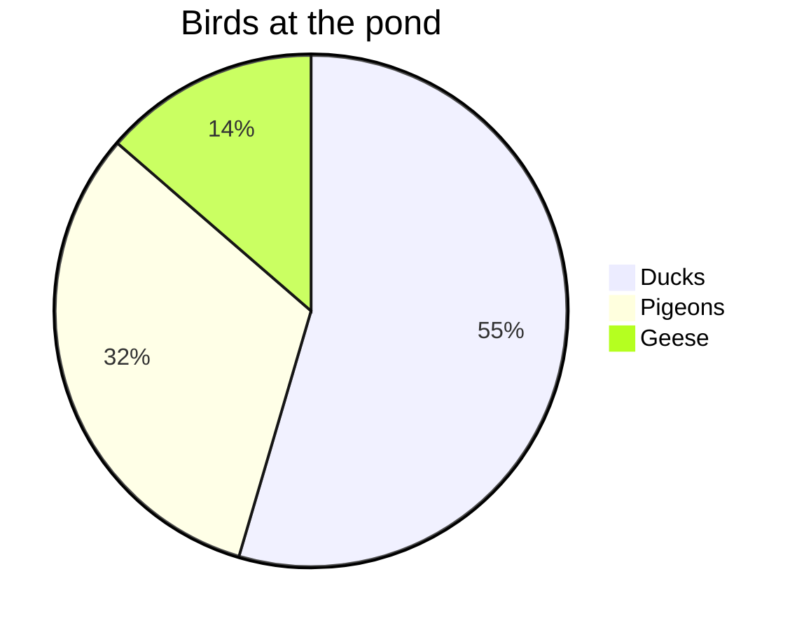

::examples
:::example{label="Flowchart"}
````md

````
:::

:::example{label="Sequence"}
````md

````
:::

:::example{label="Pie"}
````md

````
:::
::

A diagram in a review shows a flow or a schema faster than prose, and Mermaid is the syntax agents and GitHub already write. [comark-pele](https://github.com/farnabaz/comark-pele) turns each `mermaid` fence into SVG with [Pele](https://pele.run), a Mermaid renderer with no dependencies, so the page needs no script and the diagram's source never leaves your machine.

comark-pele is a third-party plugin, by [farnabaz](https://github.com/farnabaz), not one of this repository's packages. [@onmax/comark](/preset/) registers it for you and puts its diagrams on the [shared tokens](/guide/theming/), so they match the other blocks in light and dark.
