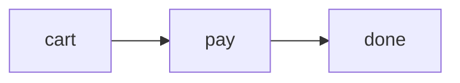

## Fences

A ` ```mermaid ` or ` ```pele ` fence becomes a diagram. Every other fence stays code. Pass `languages` to change which ones:

```ts
pele({ languages: ["mermaid"] }); // only `mermaid` fences, not `pele` ones
```

Props after the language go on the diagram's wrapper, so a class or an id reaches your styles and links:

````md

````

## Diagram types

Pele draws every diagram type built into Mermaid 12.1.0, picked by the first word of the diagram as in Mermaid:

| First word | Diagram |
| --- | --- |
| `flowchart` or `graph` | Boxes and arrows |
| `sequenceDiagram` | Messages between participants |
| `classDiagram` | Classes and their relations |
| `stateDiagram` or `stateDiagram-v2` | States and transitions |
| `erDiagram` | Entities and relationships |
| `gantt` | Tasks on a timeline |
| `pie` | Shares of a whole |
| `xychart` or `xychart-beta` | Bars and lines on axes |
| `quadrantChart` | Points in four quadrants |
| `mindmap` | A tree of ideas |
| `timeline` | Events by period |
| `gitGraph` | Branches and commits |
| `journey` | Steps of a user journey, scored |
| `kanban` | Cards in columns |
| `block`, `packet`, `architecture-beta`, `requirementDiagram`, `C4Context`, `sankey`, `radar-beta`, `treemap`, and the newer `-beta` types such as `venn-beta` | As in Mermaid |

Mermaid settings, such as a diagram's own theme, go in the diagram, in its frontmatter or a `%%{init}%%` directive.

## Failures

A diagram Pele can't draw shows its source as code, with Pele's error in the wrapper's `data-error` attribute. Nothing goes in `meta.issues`, so check a diagram in the [playground](/play/#preset=mermaid-flowchart) before you publish it.
